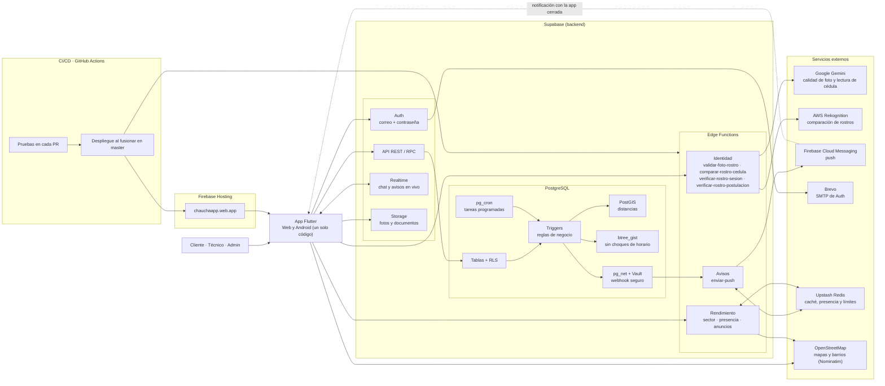
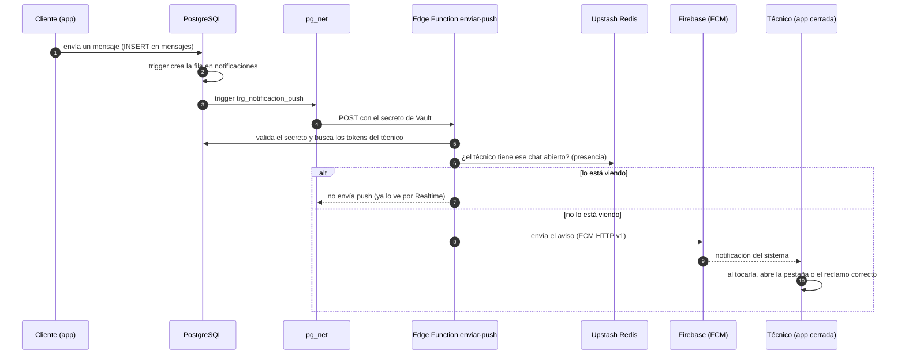
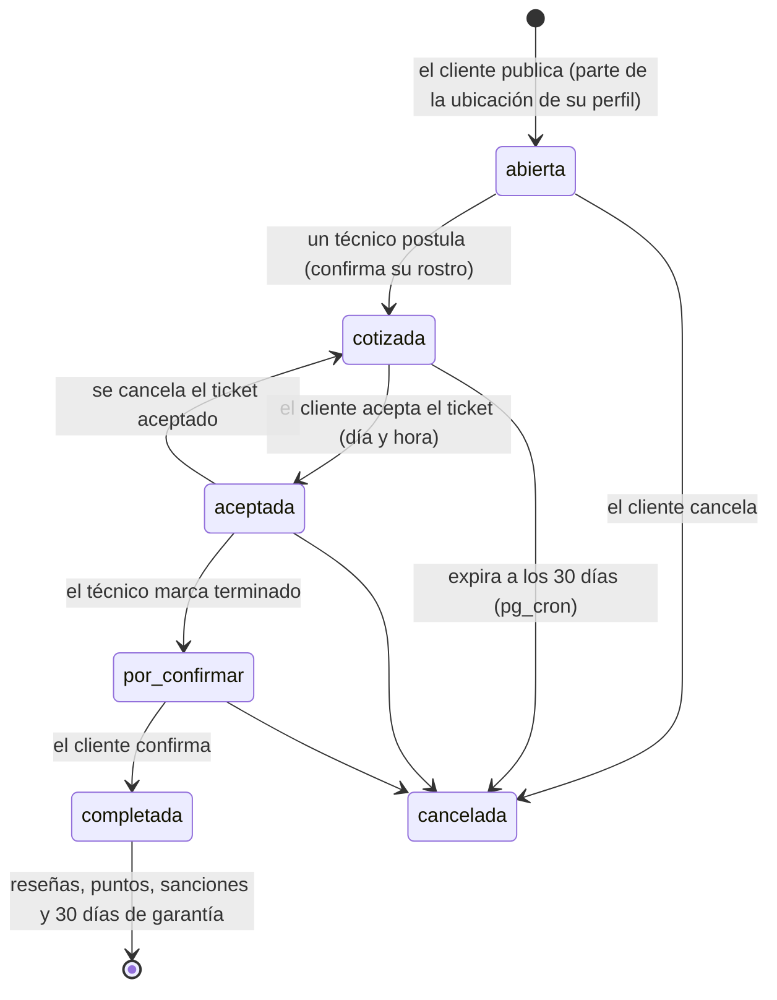
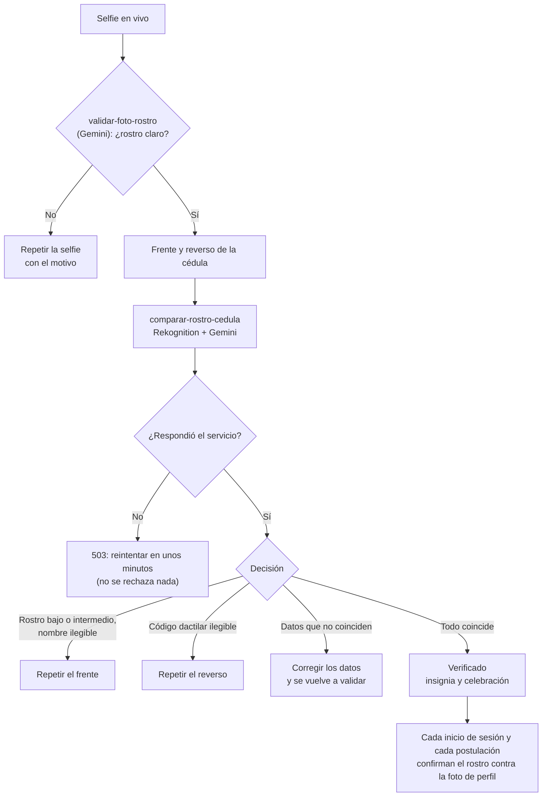
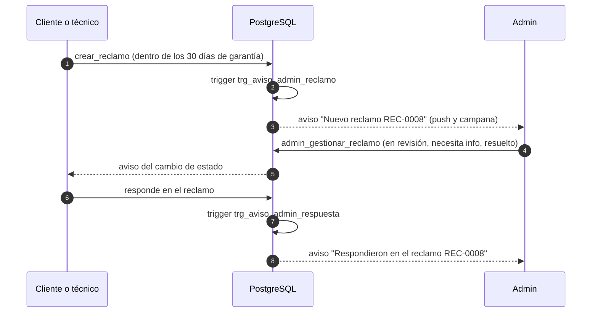
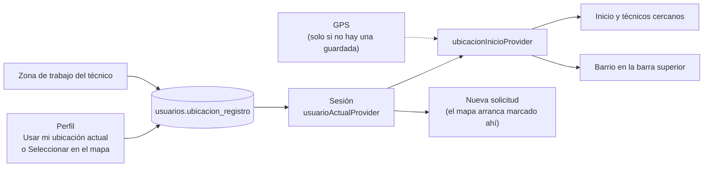
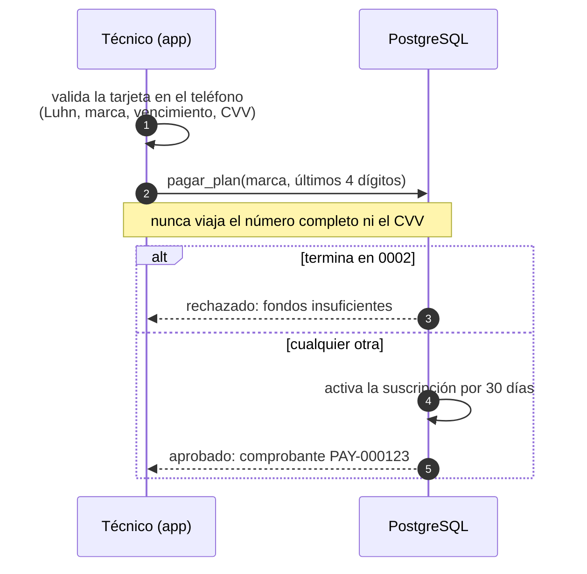
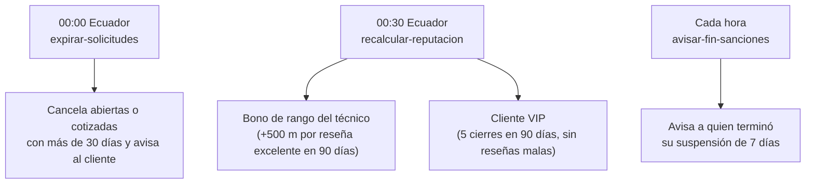
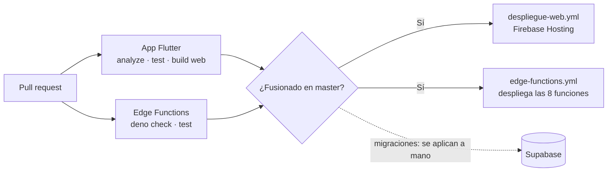

# ChauchaApp: diagramas de arquitectura

El detalle de cada pieza está en [ARQUITECTURA_TECNICA.md](ARQUITECTURA_TECNICA.md).

## 1. Vista general

## 2. Cómo llega una notificación push

## 3. Vida de una solicitud

## 4. Verificación de identidad (100 % automática)

No hay revisión manual: cuando algo no está claro, se le pide al usuario
repetir la foto concreta. El admin no interviene.

## 5. Reclamos y avisos al admin

## 6. Una sola ubicación en toda la app

## 7. Pasarela de pago simulada

## 8. Tareas programadas (pg_cron)

## 9. CI/CD

