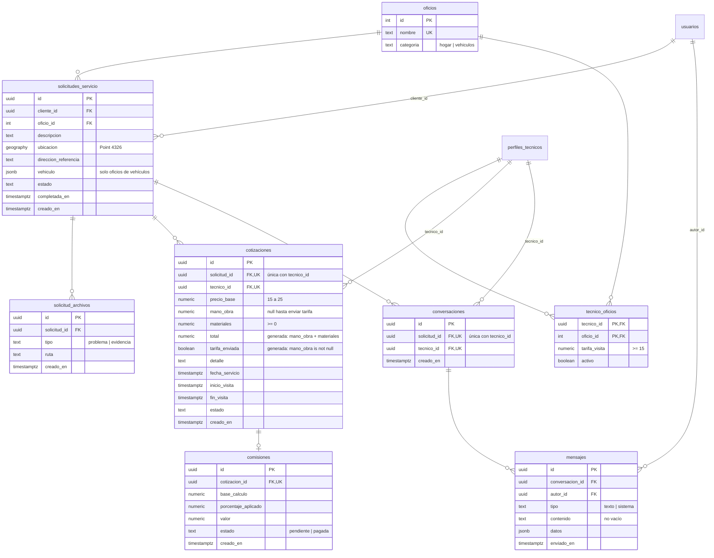
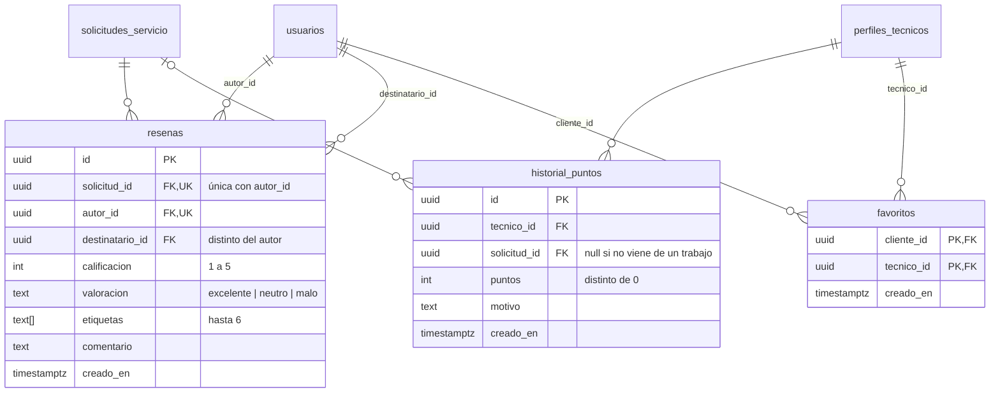
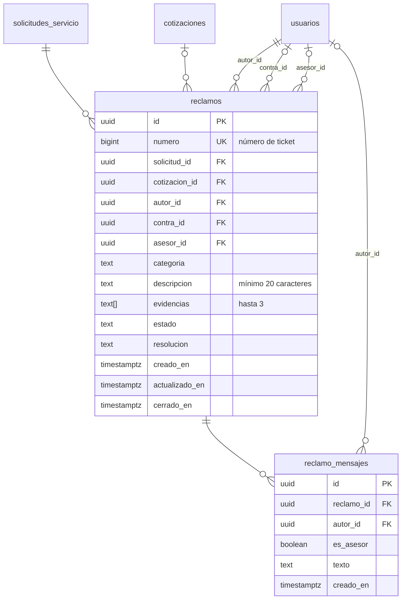
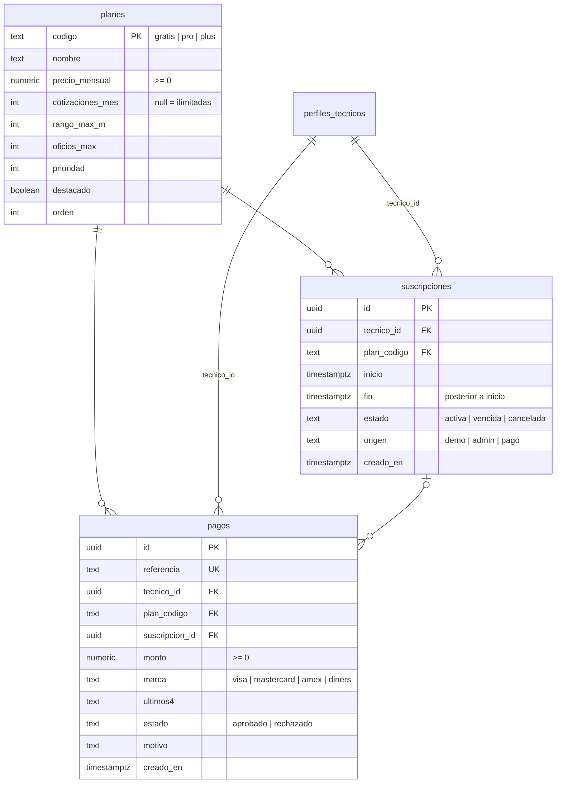
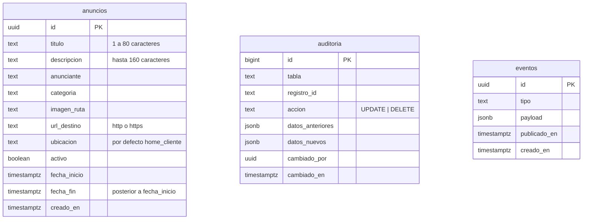

# ChauchaApp: modelo de datos

Modelo de datos del esquema `public` de Supabase (PostgreSQL 17 + PostGIS).

- **Fuente:** las migraciones de `supabase/migrations/`, hasta `20261117120000_visita_minima_15.sql`.
- **Revisado el:** 17/11/2026.
- **Tamaño:** 31 tablas. Todas tienen RLS activado.

Los diagramas usan Mermaid y GitHub los dibuja directamente. Si una migración nueva crea, cambia o borra una tabla o una clave foránea, hay que actualizar este documento en el mismo PR.

**Cómo leer los diagramas**

| Símbolo | Significado |
|---|---|
| `\|\|--o{` | uno a muchos (puede no haber ninguno) |
| `\|\|--o\|` | uno a cero o uno |
| `\|o--o{` | relación opcional: la clave foránea admite `null` |
| `PK` / `FK` / `UK` | clave primaria / clave foránea / valor único |

---

## Índice

1. [Vista general](#1-vista-general)
2. [Usuarios, identidad y verificación](#2-usuarios-identidad-y-verificación)
3. [Solicitudes, cotizaciones y chat](#3-solicitudes-cotizaciones-y-chat)
4. [Reseñas, puntos y favoritos](#4-reseñas-puntos-y-favoritos)
5. [Reclamos](#5-reclamos)
6. [Planes, suscripciones y pagos](#6-planes-suscripciones-y-pagos)
7. [Tablas sin relaciones](#7-tablas-sin-relaciones)
8. [Estados y valores permitidos](#8-estados-y-valores-permitidos)
9. [Referencias sin clave foránea](#9-referencias-sin-clave-foránea)

---

## 1. Vista general

Todas las tablas que tienen claves foráneas, sin columnas. El centro del modelo es `usuarios` (una fila por cuenta de `auth.users`) y `solicitudes_servicio` (el pedido de un cliente). Un técnico es un usuario que además tiene una fila en `perfiles_tecnicos`.

```mermaid
erDiagram
    usuarios ||--o| identidades : "tiene"
    usuarios ||--o| perfiles_tecnicos : "es técnico"
    niveles_gamificacion ||--o{ perfiles_tecnicos : "nivel"
    usuarios ||--o{ documentos_tecnico : "sube"
    usuarios ||--o{ documentos_historial : "historial"
    usuarios ||--o{ certificaciones_tecnico : "sube"
    usuarios ||--o{ comparaciones_rostro : "verifica"
    usuarios ||--o{ verificaciones_rostro_sesion : "verifica"
    usuarios ||--o{ verificaciones_postulacion : "verifica"
    usuarios ||--o{ dispositivos_push : "registra"
    usuarios ||--o{ notificaciones : "recibe"

    usuarios ||--o{ solicitudes_servicio : "pide"
    oficios ||--o{ solicitudes_servicio : "de oficio"
    oficios ||--o{ tecnico_oficios : ""
    perfiles_tecnicos ||--o{ tecnico_oficios : "ofrece"
    solicitudes_servicio ||--o{ solicitud_archivos : "fotos"
    solicitudes_servicio ||--o{ cotizaciones : "recibe"
    perfiles_tecnicos ||--o{ cotizaciones : "envía"
    cotizaciones ||--o| comisiones : "genera"
    solicitudes_servicio ||--o{ conversaciones : ""
    perfiles_tecnicos ||--o{ conversaciones : ""
    conversaciones ||--o{ mensajes : "contiene"
    usuarios ||--o{ mensajes : "escribe"

    solicitudes_servicio ||--o{ resenas : "se califica"
    usuarios ||--o{ resenas : "escribe / recibe"
    solicitudes_servicio |o--o{ historial_puntos : ""
    perfiles_tecnicos ||--o{ historial_puntos : "gana / pierde"
    usuarios ||--o{ favoritos : "guarda"
    perfiles_tecnicos ||--o{ favoritos : "guardado"

    solicitudes_servicio ||--o{ reclamos : ""
    cotizaciones |o--o{ reclamos : ""
    usuarios ||--o{ reclamos : "abre / recibe / atiende"
    reclamos ||--o{ reclamo_mensajes : "contiene"
    usuarios |o--o{ reclamo_mensajes : "escribe"

    planes ||--o{ suscripciones : ""
    perfiles_tecnicos ||--o{ suscripciones : "contrata"
    planes ||--o{ pagos : ""
    perfiles_tecnicos ||--o{ pagos : "paga"
    suscripciones |o--o{ pagos : "activa"
```

`anuncios`, `auditoria` y `eventos` no tienen claves foráneas: están en la [sección 7](#7-tablas-sin-relaciones).

---

## 2. Usuarios, identidad y verificación

`usuarios.id` es el mismo `id` de `auth.users` (clave foránea con `on delete cascade`): borrar la cuenta de Auth borra al usuario y, en cascada, casi todo lo suyo.

```mermaid
erDiagram
    usuarios ||--o| identidades : "tiene"
    usuarios ||--o| perfiles_tecnicos : "es técnico"
    niveles_gamificacion ||--o{ perfiles_tecnicos : "nivel"
    usuarios ||--o{ documentos_tecnico : "tecnico_id"
    usuarios |o--o{ documentos_tecnico : "revisado_por"
    usuarios ||--o{ documentos_historial : "tecnico_id"
    usuarios ||--o{ certificaciones_tecnico : "tecnico_id"
    usuarios ||--o{ comparaciones_rostro : ""
    usuarios ||--o{ verificaciones_rostro_sesion : ""
    usuarios ||--o{ verificaciones_postulacion : ""
    usuarios ||--o{ dispositivos_push : ""
    usuarios ||--o{ notificaciones : ""

    usuarios {
        uuid id PK, FK "auth.users.id"
        text rol "cliente | tecnico | admin"
        text nombres
        text apellidos
        text ciudad "por defecto Quito"
        text foto_perfil_ruta
        geography ubicacion_registro "Point 4326"
        boolean verificado
        boolean verificacion_vista
        boolean es_vip
        timestamptz suspendido_desde
        timestamptz suspendido_hasta
        timestamptz dado_de_baja_en
        timestamptz creado_en
    }
    identidades {
        uuid usuario_id PK, FK
        text cedula UK
        text codigo_dactilar "formato A1234B5678"
        timestamptz creado_en
    }
    perfiles_tecnicos {
        uuid usuario_id PK, FK
        int nivel_id FK
        numeric tarifa_base ">= 0"
        int rango_cobertura_m "500 a 50000"
        int rango_bonus_m "0 a 5000"
        geography ubicacion_actual "Point 4326"
        int puntos ">= 0"
        numeric calificacion_promedio "0 a 5"
        int total_resenas
        boolean verificado
    }
    niveles_gamificacion {
        int id PK
        text nombre
        int puntos_minimos UK
        numeric comision_porcentaje "0 a 100"
        int prioridad
    }
    documentos_tecnico {
        uuid id PK
        uuid tecnico_id FK
        text tipo "cedula_frontal | cedula_posterior | selfie"
        text ruta_archivo
        text estado
        text observacion
        uuid revisado_por FK
        timestamptz revisado_en
    }
    documentos_historial {
        uuid id PK
        uuid documento_id
        uuid tecnico_id FK
        text tipo
        text estado_anterior
        text estado_nuevo
        text ruta_anterior
        text ruta_nueva
        uuid cambiado_por
        timestamptz cambiado_en
    }
    certificaciones_tecnico {
        uuid id PK
        uuid tecnico_id FK
        text nombre
        text entidad
        int anio "1950 a 2100"
        text ruta_archivo
        text estado
        uuid revisado_por
        timestamptz revisado_en
        timestamptz creado_en
    }
    comparaciones_rostro {
        uuid id PK
        uuid usuario_id FK
        boolean misma_persona
        int confianza
        numeric similitud
        text decision
        text motivo
        jsonb datos
        timestamptz creado_en
    }
    verificaciones_rostro_sesion {
        uuid session_id PK, FK "auth.sessions.id"
        uuid usuario_id FK
        smallint intentos
        real ultima_similitud
        timestamptz verificado_en
        timestamptz creado_en
    }
    verificaciones_postulacion {
        uuid id PK
        uuid usuario_id FK
        text metodo "rostro"
        numeric similitud
        uuid cotizacion_id
        timestamptz usada_en
        timestamptz creado_en
    }
    dispositivos_push {
        text token PK
        uuid usuario_id FK
        text plataforma "android | ios | web"
        timestamptz actualizado_en
    }
    notificaciones {
        uuid id PK
        uuid usuario_id FK
        text tipo
        uuid referencia_id
        text contenido
        boolean leida
        timestamptz creada_en
    }
```

| Tabla | Para qué sirve |
|---|---|
| `usuarios` | Perfil de cada cuenta: rol, nombre, ciudad, verificación, VIP, suspensiones y baja. |
| `identidades` | Cédula (única) y código dactilar. Una fila como máximo por usuario. |
| `perfiles_tecnicos` | Datos que solo tiene un técnico: nivel, tarifa, rango de cobertura, ubicación en vivo, puntos y calificación. |
| `niveles_gamificacion` | Catálogo de niveles: puntos mínimos, comisión y prioridad. |
| `documentos_tecnico` | Fotos de la cédula y la selfie. Un documento por tipo y usuario (`unique (tecnico_id, tipo)`). Aunque se llame "técnico", también la usan los clientes para verificarse. |
| `documentos_historial` | Historial de cambios de estado y de archivo de cada documento. |
| `certificaciones_tecnico` | Certificados que sube el técnico y revisa el admin. |
| `comparaciones_rostro` | Resultado de comparar la selfie con la cédula (Rekognition o Gemini). |
| `verificaciones_rostro_sesion` | Verificación del rostro al iniciar sesión, una por sesión de Auth. |
| `verificaciones_postulacion` | Verificación del rostro antes de postular a una solicitud; se consume al usarla. |
| `dispositivos_push` | Tokens de Firebase Cloud Messaging por dispositivo. |
| `notificaciones` | Avisos dentro de la app. |

---

## 3. Solicitudes, cotizaciones y chat

| Tabla | Para qué sirve |
|---|---|
| `solicitudes_servicio` | Pedido de un cliente: oficio, descripción, ubicación y estado. Al completarse se guarda `completada_en`, que abre la garantía de 30 días para reclamos. |
| `oficios` | Catálogo de oficios, agrupados en `hogar` y `vehiculos`. |
| `tecnico_oficios` | Oficios que ofrece cada técnico, con su tarifa de visita. `activo` permite pausar un oficio sin borrarlo (por el límite del plan). |
| `solicitud_archivos` | Fotos del problema (las sube el cliente) y de la evidencia (las sube el técnico). |
| `cotizaciones` | Postulación de un técnico a una solicitud, una por técnico. Primero tiene solo el `precio_base` de la visita; después, la tarifa (`mano_obra` + `materiales`) y la fecha. |
| `comisiones` | Comisión de la plataforma por cada cotización aceptada (una como máximo). |
| `conversaciones` | Chat entre el cliente de una solicitud y un técnico, uno por pareja. |
| `mensajes` | Mensajes del chat. Los de tipo `sistema` los genera la base (por ejemplo, los avisos sobre la tarifa) y llevan su información en `datos`. |

Reglas que impone la base en `cotizaciones`:

- No se puede aceptar una cotización sin tarifa (`ck_cotizaciones_aceptada_con_tarifa`), ni ponerle fecha sin tarifa (`ck_cotizaciones_fecha_con_tarifa`).
- `fin_visita` tiene que ser posterior a `inicio_visita`.
- Un técnico no puede tener dos visitas aceptadas que se crucen en el tiempo (restricción `exclude using gist`, `ex_cotizaciones_sin_choque`).
- La visita cuesta al menos $15: lo exigen los triggers `trg_visita_minima_oficio` (precio por oficio en `tecnico_oficios.tarifa_visita`) y `trg_cotizacion_visita_minima` (`precio_base` de las ofertas nuevas y `mano_obra` del ticket). Las ofertas anteriores a la regla se respetan.

El chat se guarda con una conversación por solicitud y técnico, pero la app junta las de la misma pareja cliente-técnico en un solo chat: la lista muestra una fila por persona y el hilo trae los mensajes de todas.

---

## 4. Reseñas, puntos y favoritos

| Tabla | Para qué sirve |
|---|---|
| `resenas` | Calificación de un trabajo. Cliente y técnico se califican entre sí: como máximo una reseña por autor y solicitud. |
| `historial_puntos` | Movimientos de puntos del técnico (trabajos y sanciones). Su suma explica `perfiles_tecnicos.puntos`. |
| `favoritos` | Técnicos que un cliente guardó. |

---

## 5. Reclamos

| Tabla | Para qué sirve |
|---|---|
| `reclamos` | Reclamo de un cliente o un técnico sobre un trabajo. `contra_id` es la otra parte y `asesor_id` es el admin que lo atiende. |
| `reclamo_mensajes` | Conversación del reclamo entre el autor y el asesor. |

---

## 6. Planes, suscripciones y pagos

El cobro es una **simulación** (demostración): `pagos` guarda solo la marca y los últimos cuatro dígitos de la tarjeta.

| Tabla | Para qué sirve |
|---|---|
| `planes` | Catálogo de planes del técnico con sus límites: cotizaciones al mes, rango y oficios. |
| `suscripciones` | Plan contratado por un técnico durante un período. |
| `pagos` | Intentos de pago simulados. Si se aprueba, apunta a la suscripción que activó. |

---

## 7. Tablas sin relaciones

| Tabla | Para qué sirve |
|---|---|
| `anuncios` | Banners de comercios en la app del cliente, con vigencia por fechas. |
| `auditoria` | Registro de cambios y borrados que escriben los triggers. |
| `eventos` | Bandeja de eventos de dominio (patrón *outbox*). |

---

## 8. Estados y valores permitidos

Valores que la base acepta en las columnas de texto con `check`:

| Tabla.columna | Valores |
|---|---|
| `usuarios.rol` | `cliente`, `tecnico`, `admin` |
| `solicitudes_servicio.estado` | `abierta`, `cotizada`, `aceptada`, `por_confirmar`, `completada`, `cancelada` |
| `cotizaciones.estado` | `pendiente`, `aceptada`, `rechazada` |
| `comisiones.estado` | `pendiente`, `pagada` |
| `documentos_tecnico.estado` | `pendiente`, `aprobada`, `rechazada` |
| `documentos_tecnico.tipo` | `cedula_frontal`, `cedula_posterior`, `selfie` |
| `certificaciones_tecnico.estado` | `pendiente`, `aprobada`, `rechazada` |
| `comparaciones_rostro.decision` | `aprobada`, `revision`, `rechazada`, `datos` |
| `verificaciones_postulacion.metodo` | `rostro` |
| `solicitud_archivos.tipo` | `problema`, `evidencia` |
| `mensajes.tipo` | `texto`, `sistema` |
| `resenas.valoracion` | `excelente`, `neutro`, `malo` |
| `reclamos.categoria` | `falla_trabajo`, `no_se_presento`, `trato`, `cobro_indebido`, `otro` |
| `reclamos.estado` | `recibido`, `en_revision`, `necesita_info`, `resuelto`, `rechazado` |
| `oficios.categoria` | `hogar`, `vehiculos` |
| `planes.codigo` | `gratis`, `pro`, `plus` |
| `suscripciones.estado` | `activa`, `vencida`, `cancelada` |
| `suscripciones.origen` | `demo`, `admin`, `pago` |
| `pagos.estado` | `aprobado`, `rechazado` |
| `pagos.marca` | `visa`, `mastercard`, `amex`, `diners` |
| `dispositivos_push.plataforma` | `android`, `ios`, `web` |
| `anuncios.categoria` | `ferreteria`, `restaurante`, `cafeteria`, `pinturas`, `lavanderia`, `materiales`, `otro` |
| `auditoria.accion` | `UPDATE`, `DELETE` |

---

## 9. Referencias sin clave foránea

Estas columnas guardan el `id` de otra tabla, pero la base no lo valida con una clave foránea. Al borrar la fila referida, el valor queda huérfano:

| Columna | Apunta a |
|---|---|
| `documentos_historial.documento_id` | `documentos_tecnico.id` (el historial sobrevive al documento) |
| `documentos_historial.cambiado_por` | `usuarios.id` |
| `certificaciones_tecnico.revisado_por` | `usuarios.id` (admin) |
| `verificaciones_postulacion.cotizacion_id` | `cotizaciones.id` |
| `notificaciones.referencia_id` | Depende de `tipo`: solicitud, cotización, reclamo… |
| `auditoria.registro_id` / `auditoria.cambiado_por` | Fila auditada / `usuarios.id` |
